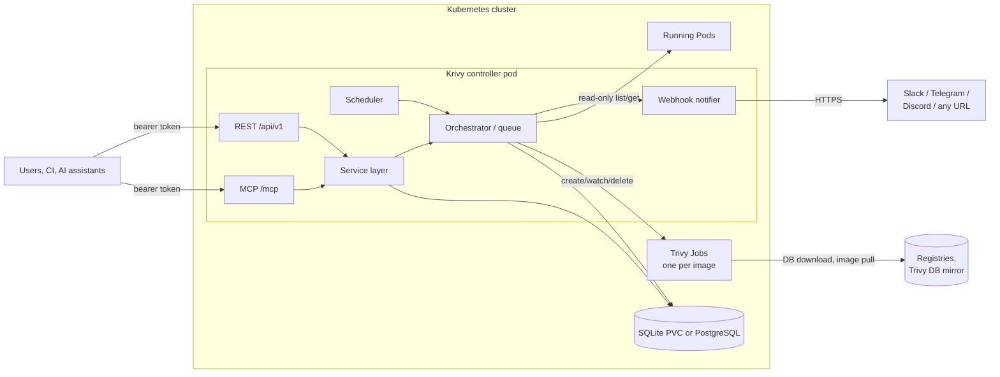

# Krivy

Krivy is a small Kubernetes controller that finds the container images your
cluster is running, scans each one for vulnerabilities with
[Trivy](https://trivy.dev), and keeps track of the findings over time.

It is a single controller process that contains:

* a **scheduler** that queues a full-cluster scan every 12 hours by default;
* a **scan orchestrator** that runs **one ephemeral Trivy Job per
  deduplicated image**, so an image used by ten Deployments is scanned once;
* a **REST API** (`/api/v1`) and an **MCP server** (`/mcp`) for people,
  CI and AI assistants;
* **webhook notifications** for new critical findings, resolved findings and
  failed scans.

By default Krivy reports `CRITICAL` vulnerabilities only.

## Features

* Discovers images from running and pending Pods (containers, init and
  ephemeral containers) with read-only RBAC, and resolves owners to
  Deployment, StatefulSet, DaemonSet, CronJob, Job or bare Pod.
* Scans by running digest (`repository@sha256:…`) when the kubelet reports
  one, so a re-pushed tag is tracked as a separate image.
* Hardened scanner Jobs: no PersistentVolume, no ServiceAccount token,
  non-root, read-only root filesystem, all capabilities dropped, bounded
  `emptyDir` scratch space, a deadline and a TTL.
* Persistent queue in SQLite (default) or PostgreSQL. Duplicate requests are
  merged, scans can be cancelled, and a restarted controller picks up where it
  left off.
* Stable finding IDs; findings resolve automatically when fixed or no longer
  deployed, and reopen if they come back.
* Acknowledgements and silences (by finding, image, namespace or
  vulnerability) to keep alerts quiet without hiding data.
* Static bearer tokens with `read` < `scan` < `manage` scopes, shared by REST
  and MCP.
* Template-based webhooks (Telegram, Discord, Slack, generic JSON) with SSRF
  protection, retries and dedupe.
* Helm chart published as an OCI artifact.

## Quickstart

Requires Kubernetes ≥ 1.27 and Helm ≥ 3.14. Scanner pods need outbound
internet access to download the Trivy DB and pull the scanned images.

```sh
kubectl create namespace krivy-system
kubectl -n krivy-system create secret generic krivy-secrets \
  --from-literal=KRIVY_TOKEN_ADMIN="$(openssl rand -hex 24)"

helm install krivy oci://ghcr.io/l4r-s/charts/krivy \
  --namespace krivy-system --version 0.1.0 \
  --set existingSecret=krivy-secrets \
  --set 'auth.tokens[0].name=admin' \
  --set 'auth.tokens[0].scopes={read,scan,manage}'
```

The token entry named `admin` reads its value from `KRIVY_TOKEN_ADMIN`.
Trigger a scan and look at the results:

```sh
kubectl -n krivy-system port-forward svc/krivy 8080:8080 &
TOKEN=$(kubectl -n krivy-system get secret krivy-secrets \
  -o jsonpath='{.data.KRIVY_TOKEN_ADMIN}' | base64 -d)

curl -sS -X POST -H "Authorization: Bearer $TOKEN" localhost:8080/api/v1/scans
curl -sS -H "Authorization: Bearer $TOKEN" localhost:8080/api/v1/scans
curl -sS -H "Authorization: Bearer $TOKEN" localhost:8080/api/v1/summary
```

Connect Claude Code to the MCP server:

```sh
claude mcp add --transport http krivy http://localhost:8080/mcp \
  --header "Authorization: Bearer $TOKEN"
```

See [docs/installation.md](docs/installation.md) for PostgreSQL, private
registries, webhooks, NetworkPolicies and Ingress.

## Architecture



Details: [docs/architecture.md](docs/architecture.md).

## Documentation

| Document | Contents |
|---|---|
| [Installation](docs/installation.md) | Helm install, database, tokens, private registries, NetworkPolicy, upgrades |
| [Private registries](docs/private-registries.md) | Registry credential Secrets (GHCR, generic, Docker Hub), selection rules, rotation, errors |
| [Configuration](docs/configuration.md) | Every config key with defaults, `${ENV}` substitution, env overrides |
| [Architecture](docs/architecture.md) | Components, data model, scan lifecycle, recovery, resources |
| [Security model](docs/security-model.md) | RBAC, scanner hardening, tokens, SSRF, data leaving the cluster |
| [REST API](docs/api.md) | Endpoints, scopes, errors, pagination (OpenAPI at `/api/v1/openapi.yaml`) |
| [MCP server](docs/mcp.md) | Tools and client setup |
| [Acknowledgements and silences](docs/acknowledgements-and-silences.md) | Alert suppression semantics |
| [Webhooks](docs/webhooks.md) | Destinations, templates, delivery, SSRF protection |
| [Development](docs/development.md) | Local k3d cluster, make targets, tests |
| [Chart README](charts/krivy/README.md) | Helm values reference |
| [Contributing](CONTRIBUTING.md) · [Security policy](SECURITY.md) · [Changelog](CHANGELOG.md) | |

## Limitations

* **One controller replica.** The queue and scheduler assume a single
  process; there is no leader election.
* **Every scan downloads the Trivy DB.** Scanner Jobs have no persistent
  cache, which costs bandwidth (tens of MiB per Job) and time per image.
* **Scanner pods need egress** to the Trivy DB mirror (`ghcr.io` /
  `mirror.gcr.io`) and to every registry they scan. Air-gapped clusters need a
  mirror and `trivy.extraArgs` such as `--db-repository`.
* **Private registries need dockerconfigjson or basic-auth
  (server/username/password) Secrets** that you create in the job namespace
  and list in `kubernetes.registryAuth.existingSecrets`
  ([details](docs/private-registries.md)). Krivy does not reuse the
  `imagePullSecrets` of your workloads or k3s `registries.yaml`.
* **Static tokens only.** No OAuth, OIDC or per-user accounts. Changing or
  revoking a token needs a config change and a restart.
* **Webhooks are outbound only** and configured only in the config file; there
  are no interactive buttons or callbacks.
* **Point-in-time scans.** Krivy scans on a schedule or on request; it does not
  scan on Pod creation and does not block deployments.
* Only vulnerability scanning (`--scanners vuln`); no misconfiguration,
  secret or license scanning.

## License

[MIT](LICENSE)
