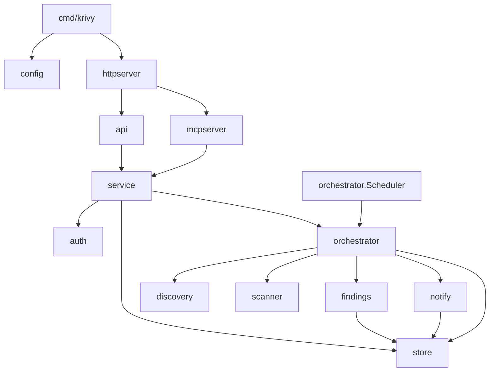
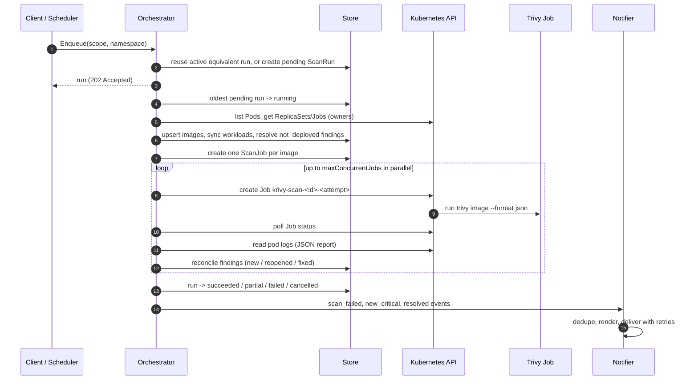

# Architecture

Krivy is one Go binary (`cmd/krivy`) running as a single-replica Deployment.
Everything except the actual vulnerability scan happens inside that process;
each scan runs in a short-lived Kubernetes Job using the official Trivy image.

## Components

| Package | Role |
|---|---|
| `internal/config` | Loads the YAML config, substitutes `${ENV}` references, applies defaults, validates. |
| `internal/kube` | Builds the client-go client (in-cluster, or a kubeconfig restricted to one context). |
| `internal/discovery` | Lists Pods (read-only) and returns deduplicated images with the workloads that use them. |
| `internal/scanner` | Renders, creates and watches one Trivy Job per image; parses the JSON report; classifies failures. |
| `internal/orchestrator` | Persistent scan queue, per-run fan-out with bounded concurrency, retries, recovery, cancellation, and the scheduler. |
| `internal/findings` | Reconciles scan results into findings; acknowledgement and silence policy. |
| `internal/store` | GORM persistence for SQLite and PostgreSQL, with schema migrations run on startup. |
| `internal/service` | Business operations shared by REST and MCP, including scope checks. |
| `internal/auth` | Static bearer tokens and scopes. |
| `internal/api` | REST handlers and the embedded OpenAPI document. |
| `internal/mcpserver` | MCP server (Streamable HTTP) exposing the same operations as tools. |
| `internal/notify` | Webhook engine: templates, delivery queue, retries, dedupe, SSRF guard. |
| `internal/httpserver` | Root mux: `/healthz`, `/readyz`, `/version`, `/api/`, `/mcp`. |

## Data model

| Table | Meaning |
|---|---|
| `ScanRun` | One cluster or namespace scan: status, trigger (`schedule`, `api`, `mcp`), requester, image counts, new/resolved counts. |
| `ScanJob` | The scan of one image within a run: attempts, Kubernetes Job name, error, diagnostics, vulnerability count. |
| `Image` | A deduplicated image identity. The key is `repository@digest` when the running digest is known, otherwise the normalized reference (`docker.io/library/nginx:1.27`). Tracks `deployed`, first/last seen and last scanned. |
| `Workload` | Links an image to a namespace, owner kind/name and container. Rows are marked inactive when the workload disappears. |
| `Finding` | One vulnerability in one package of one image: status `open`/`resolved`, resolution reason, acknowledgement, advisory data. |
| `Silence` | Alert suppression by `finding`, `image`, `namespace` or `vulnerability`, with optional expiry and revocation. |
| `NotificationDelivery` | One webhook delivery with dedupe key, status, attempts and redacted last error. |

**Finding IDs are stable.** The ID is the SHA-256 of image key,
vulnerability ID, package name, package path and installed version. Rescanning
the same image finds the same IDs, so acknowledgements and silences keep
applying.

**Image identity.** Discovery prefers the digest from
`containerStatuses[].imageID`. If the runtime reports no digest (for example
a Pod that has not started yet), Krivy falls back to the tag reference and
logs a discovery warning. Docker Hub short names are normalized
(`nginx` → `docker.io/library/nginx`).

## Scan lifecycle

1. **Enqueue.** A request is merged into existing work when possible: if an
   active (pending or running, not cancel-requested) run has the same scope
   and namespace, or an active cluster run exists, that run is returned and
   no new run is created. The REST API returns `202` either way.
2. **One run at a time.** The orchestrator processes runs strictly in order,
   oldest pending first. Runs never overlap.
3. **Discovery and preparation.** Pods in phase `Pending` or `Running` are
   listed (paginated, 500 per page). Cluster scans skip
   `kubernetes.excludeNamespaces`; with `kubernetes.watchNamespace` set,
   cluster scans cover only that namespace and namespace scans for other
   namespaces are rejected. Workload rows are synced, and open findings whose
   image is no longer deployed anywhere are resolved with reason
   `not_deployed`.
4. **Fan-out.** One `ScanJob` per image, run with at most
   `scan.maxConcurrentJobs` Kubernetes Jobs at once.
5. **Per-image retries.** Retryable failures are retried until
   `scan.maxAttempts` attempts are used, with a 10 s × attempt backoff. Each
   attempt is a new Job with a new name.
6. **Reconcile.** Only a successful scan touches findings, and only those of
   the scanned image. Reported vulnerabilities are created, refreshed or
   reopened. Open findings that are no longer reported resolve with reason
   `fixed`. A failed image scan never resolves anything.
7. **Finish.** The run status is:

   | Status | When |
   |---|---|
   | `succeeded` | Every image scanned successfully (or there were no images). |
   | `partial` | Some images failed or were cancelled, at least one succeeded. |
   | `failed` | Discovery failed, or every image scan failed. |
   | `cancelled` | A user cancelled the run. Takes precedence over the others. |

8. **Notify.** `scan_failed` is raised for `failed` and `partial` runs.
   `new_critical` and `resolved` are raised after applying acknowledgements
   and silences ([details](acknowledgements-and-silences.md)).

### Scanner failure classification

| Kind | Retryable | Cause |
|---|---|---|
| `timeout` | yes | Job exceeded `trivy.timeout` (`activeDeadlineSeconds`). |
| `scheduling` | yes | Pod unschedulable, or the Trivy image cannot be pulled, for longer than 3 minutes. The Job is deleted. |
| `scanner` | yes | Trivy exited non-zero, was OOM-killed, or failed to download its DB (including rate limiting). |
| `registry_auth` | **no** | A `registryAuth` Secret is missing, unreadable or invalid (no Job is created), a basic-auth Secret changed while its Job started (the `registry-auth` init container failed), or the registry answered unauthorized/denied/403 for the scanned image. See [private registries](private-registries.md#errors). |
| `image_pull` | **no** | Trivy could not find the scanned image (manifest unknown, name unknown, not found). |
| `output` | no if too large, otherwise yes | Report larger than `trivy.maxOutputBytes`, missing, truncated or not valid JSON. |
| `kubernetes` | yes, except forbidden / invalid / unauthorized | API errors creating or watching the Job. |

Diagnostics (Job condition, pod status, last 4 KiB of logs) are stored on the
`ScanJob` with credential-looking strings redacted, and are visible through
`GET /api/v1/scans/{id}`.

## Cancellation

`POST /api/v1/scans/{id}/cancel` (or the MCP equivalent):

* A **pending** run becomes `cancelled` immediately.
* A **running** run is flagged `cancelRequested`; in-flight scans are
  stopped and their Kubernetes Jobs are deleted, remaining images are marked
  `cancelled`, and the run finishes as `cancelled`.
* A finished run is returned unchanged.

## Restart recovery

Queue state lives in the database, and Job names are deterministic
(`krivy-scan-<first 8 chars of scan job id>-<attempt>`).

* On shutdown, in-flight Kubernetes Jobs are **not** deleted, and the run
  stays `running` in the database.
* On startup, runs left `running` are reset to `pending`. When the run is
  processed again, finished image jobs are skipped and running ones re-attach
  to their existing Kubernetes Job (create returns `AlreadyExists`, Krivy
  then watches it). A Job that finished while the controller was down is
  collected if its pod still exists; if only the pod is gone the attempt
  fails as retryable `output`, and if the TTL already removed the Job it is
  simply created again.
* A cancellation requested before the restart is honoured.
* Pending webhook deliveries older than 5 minutes are marked failed and not
  replayed.

## Scheduler

The scheduler checks once a minute whether a cluster scan is due and enqueues
one with trigger `schedule`. The schedule is **anchored at the creation time
of the latest cluster run** (from any trigger), so restarts neither skip nor
double-trigger scans: if the controller was down past the due time, a scan is
queued right after startup.

With no cluster scan in the history, `scan.scanOnStartup: true` queues one
immediately; otherwise the first scan runs one interval after the controller
started. `scan.schedule: "off"` disables the scheduler; manual scans still
work.

## Concurrency

* One controller replica. There is no leader election; do not scale the
  Deployment beyond 1.
* One scan run at a time; up to `scan.maxConcurrentJobs` (1–50, default 1)
  Trivy Jobs within it.
* REST and MCP requests are served concurrently; enqueue and cancel are
  serialized internally.
* Webhooks are delivered by a pool of 4 background workers from a bounded
  in-memory queue (256 entries), so slow endpoints never block scans.

## Scanner Jobs have no persistent cache

Each scanner Job gets two `emptyDir` volumes (`/tmp` and the Trivy cache),
both bounded by the ephemeral-storage limit. There is no PVC and no shared
cache, so **every Job downloads the Trivy vulnerability DB** (~60–80 MiB
compressed, several hundred MiB unpacked).

This is deliberate:

* No ReadWriteMany storage requirement and no stuck volume attachments.
* No shared writable state between scans of untrusted images, and no cache
  poisoning across scans.
* Jobs can run on any node and are fully cleaned up by TTL.

The cost is bandwidth and time per image, plus enough memory and ephemeral
storage for the unpacked DB in every Job. If this matters, lower the number
of images scanned per run (`excludeNamespaces`, `watchNamespace`), scan less
often, or point Trivy at a nearby DB mirror via `trivy.extraArgs`
(`--db-repository`).

## Resource expectations

| Component | Requests | Limits | Notes |
|---|---|---|---|
| Controller | 50m CPU, 64Mi | 256Mi memory | Chart defaults. Mostly idle between scans. |
| Each Trivy Job | 100m CPU, 256Mi, 512Mi ephemeral | 1Gi memory, 2Gi ephemeral | `trivy.resources`. Large images may need more memory. |
| SQLite volume | 1Gi PVC | | Findings and history are small; 1Gi is plenty for most clusters. |

Peak usage during a scan is roughly `maxConcurrentJobs ×` the Trivy Job
limits. Scan duration is dominated by the DB download and the image pull;
expect tens of seconds to a few minutes per image.
